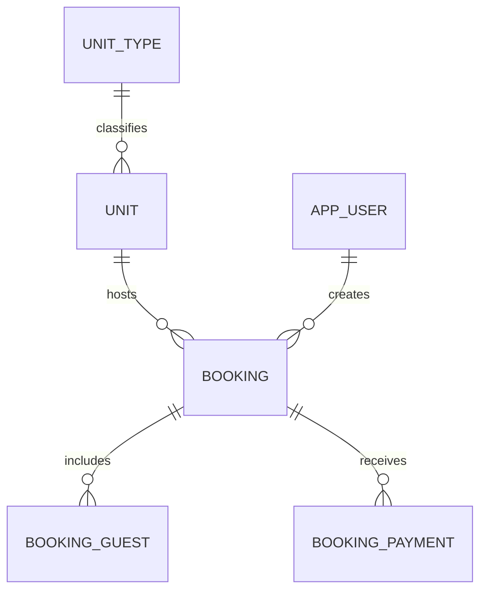

# Database Design with PostgreSQL

This database serves one property: my dad's lodge. There is no org entity or multi-tenancy. Expected scale is at most 700 bookings and 1000 guests per month.

## Tables and Relationships



A unit has one current unit type and many bookings over time. A reservation may have no guest records yet; a booking with an actual check-in must have at least one guest. The conditional minimum guest count is to be enforced by the application.

## Field conventions

Every table has these fields in addition to the fields listed in its section:

| Field | PostgreSQL type | Rule |
| --- | --- | --- |
| `id` | `uuid` | Primary key, generated when the record is created. |
| `created_at` | `timestamptz` | Required; defaults to the creation time. |
| `updated_at` | `timestamptz` | Required; set on creation and maintained on updates. |

Fields are required unless marked nullable. Table names are plural, and field names use snake case.

Required text fields must be nonblank after trimming, including unit type names and unit labels. Every table rejects non-finite numeric values and timestamps; positivity checks alone are insufficient for PostgreSQL numeric `NaN`. Check constraints restrict ID types to the supported values.

Stored amounts use `numeric(12,2)`, and calculations use decimal arithmetic. PostgreSQL recommends `numeric` when monetary exactness matters; a two-decimal column rounds incoming values, so the agreed truncation and upward tax rounding are applied explicitly before storing the results. [PostgreSQL numeric types](https://www.postgresql.org/docs/current/datatype-numeric.html).

Event timestamps use `timestamptz`. The property's named timezone is stored separately for display and reporting, because `timestamptz` does not retain the original timezone name. [PostgreSQL date and time types](https://www.postgresql.org/docs/current/datatype-datetime.html).

## Property configuration

Keep the lodge's details in one shared application configuration. Receipts and reports shall read from this same configuration. No table is required for this.

## App user

Table: `app_users`

| Field | Type | Meaning |
| --- | --- | --- |
| `username` | `text` | Login name, unique across the application after trimming and case normalization. |
| `password_hash` | `text` | Encoded salted password hash, including the algorithm and its parameters. |
| `display_name` | `text` | User's name in the application. |
| `email` | `text`, nullable | Contact or display information. |
| `is_active` | `boolean` | Defaults to `true`; disabled users cannot access the application. |

Constraints: unique index on `lower(btrim(username))`. Provisioning and login apply the same username normalization.

The backend generates usernames and passwords and provisions users through a script or admin API. There is no self-service registration. Passwords are hashed with Argon2id before storage; `password_hash` stores the library's encoded hash, including its salt and parameters. Plaintext passwords are not stored, and there is no separate salt column. [OWASP password storage](https://cheatsheetseries.owasp.org/cheatsheets/Password_Storage_Cheat_Sheet.html).

Active, authenticated users have access to the lodge's data. Separate staff roles are outside the current scope.

## Unit type

Table: `unit_types`

| Field | Type | Meaning |
| --- | --- | --- |
| `name` | `text` | For example, `Double Bedroom`. |
| `default_daily_total_rent` | `numeric(12,2)` | Default tax-inclusive rent per billing day. |
| `is_active` | `boolean` | Defaults to `true`; retired types remain available for historical references. |

Constraints: name unique across `unit_types` after trimming and case normalization; `default_daily_total_rent > 0`.

A billing day means 24 elapsed hours. The default is used to prefill a booking, which is allowed to be edited.

## Unit

Table: `units`

| Field | Type | Meaning |
| --- | --- | --- |
| `unit_type_id` | `uuid` | Current unit type. |
| `label` | `text` | Display identifier such as `201`, `A-01`, or `Dorm 2`. |
| `is_active` | `boolean` | Defaults to `true`; inactive units cannot receive new bookings. |

Constraints: foreign key `unit_type_id` to `unit_types(id)`; label unique across `units` after trimming and case normalization.

The UUID identifies the unit internally. Its label is text, not an integer. Availability is derived from bookings.

## Booking

Table: `bookings`

A booking holds the shared details of a reservation or stay, including one guest address. Guest names and IDs belong to `booking_guests`. Every reservation is assigned to a particular unit when created.

| Field | Type | Meaning |
| --- | --- | --- |
| `unit_id` | `uuid` | Particular unit allocated to this booking. |
| `created_by_user_id` | `uuid` | User who entered the booking. |
| `booking_number` | `bigint` | Unique generated reference for display and receipt lookup; gaps are acceptable. |
| `unit_label_snapshot` | `text` | Unit label when booked, preserving historical receipt and ledger details. |
| `unit_type_name_snapshot` | `text` | Unit type name when booked. |
| `contact_name` | `text`, nullable | Reservation contact's name; required for reservations, optional for walk-ins. |
| `contact_phone` | `text`, nullable | Reservation contact's phone number; required for reservations, optional for walk-ins. |
| `guest_address` | `text`, nullable | One address provided for the stay; required and nonblank once actual check-in is recorded. |
| `purpose_of_visit` | `text`, nullable | Shared purpose for this booking; required and nonblank once actual check-in is recorded. |
| `scheduled_check_in` | `timestamptz`, nullable | Scheduled arrival for a reservation; null for walk-ins and retained after the reserved guest arrives. |
| `checked_in_at` | `timestamptz`, nullable | Actual arrival; null until the guest checks in. |
| `booked_days` | `integer` | Number of billing days selected. |
| `scheduled_checkout` | `timestamptz` | Expected departure time, with a manual override allowed. |
| `checked_out_at` | `timestamptz`, nullable | Actual departure; null until the guest checks out. |
| `cancelled_at` | `timestamptz`, nullable | Cancellation time for a reservation that has not checked in. |
| `default_daily_total_rent_snapshot` | `numeric(12,2)` | Unit type's tax-inclusive daily default total rent when the booking was created. |
| `total_rent` | `numeric(12,2)` | Final tax-inclusive rent for the whole stay, including any manual override. |
| `base_rent` | `numeric(12,2)` | Final base rent: total minus the finalized CGST and SGST amounts. |
| `cgst` | `numeric(12,2)` | Final CGST amount. |
| `sgst` | `numeric(12,2)` | Final SGST amount. |

Constraints:

- Foreign key `unit_id` to `units(id)`; foreign key `created_by_user_id` to `app_users(id)`.
- Unique `booking_number`.
- `booked_days > 0`; at least one of `scheduled_check_in` and `checked_in_at` must be nonnull.
- `scheduled_checkout` must be strictly after each supplied arrival timestamp: `scheduled_check_in` and `checked_in_at`.
- `checked_out_at` must be null, or `checked_in_at` must be nonnull and strictly earlier than `checked_out_at`.
- `cancelled_at` must be null, or both `checked_in_at` and `checked_out_at` must be null.
- When `scheduled_check_in` is nonnull, both contact fields must be nonnull and nonblank. The contact need not be an occupant.
- When `checked_in_at` is nonnull, `guest_address` and `purpose_of_visit` must both be nonnull and nonblank.
- `default_daily_total_rent_snapshot > 0`, `total_rent > 0`, and nonnegative base and tax amounts.
- `total_rent = base_rent + cgst + sgst` exactly.
- Required textual values are nonblank. Non-finite numeric values and timestamps are rejected.
- No conflicting allocations for reservations and occupied bookings through their scheduled checkout, and no overlapping actual stays, for the same unit, as described below.

The total need not equal daily default times days, because the user can override the stay total. Similarly, scheduled checkout need not equal the calculated time, because the user can override that time. `booked_days` records the billing choice even when the final checkout differs.

Changes to unit type rates must not recalculate saved rates.

State is derived from timestamps, without a separate booking status column:

| State | Condition |
| --- | --- |
| Reserved | `checked_in_at IS NULL AND cancelled_at IS NULL`; `scheduled_check_in` is present. |
| Occupied | `checked_in_at IS NOT NULL AND checked_out_at IS NULL`. |
| Checked out | `checked_out_at IS NOT NULL`. |
| Cancelled | `cancelled_at IS NOT NULL`; both actual timestamps are null. |

### Occupancy constraints

Two PostgreSQL exclusion constraints enforce the occupancy rules with the `btree_gist` extension.

The extension is enabled once per database before the constraints are created. It supplies GiST support for equality comparisons on the UUID `unit_id`:

```sql
CREATE EXTENSION IF NOT EXISTS btree_gist;
```

The first constraint prevents conflicting allocations while a reservation or stay remains open. It uses scheduled arrival before check-in and actual arrival afterward, including early arrivals. Cancelled reservations and completed stays are excluded:

```sql
-- Constraint fragment for the bookings table.
CONSTRAINT bookings_no_expected_overlap
EXCLUDE USING gist (
    unit_id WITH =,
    tstzrange(
        COALESCE(checked_in_at, scheduled_check_in),
        scheduled_checkout,
        '[]'
    ) WITH &&
)
WHERE (cancelled_at IS NULL AND checked_out_at IS NULL)
```

The second constraint prevents overlapping actual stays, including historical overlaps. An unchecked-out stay has an unbounded end, so an overdue guest still occupies the unit. Reservations without an actual check-in are excluded:

```sql
-- Constraint fragment for the bookings table.
CONSTRAINT bookings_no_actual_overlap
EXCLUDE USING gist (
    unit_id WITH =,
    tstzrange(checked_in_at, checked_out_at, '[]') WITH &&
)
WHERE (checked_in_at IS NOT NULL)
```

Both use `[]`, so a checkout and the next check-in for the same unit cannot share a timestamp. Recording actual departure removes the completed stay from the first constraint while preserving its actual occupancy history. [Range constraints](https://www.postgresql.org/docs/current/rangetypes.html#RANGETYPES-CONSTRAINT), [Exclusion predicates](https://www.postgresql.org/docs/current/sql-createtable.html#SQL-CREATETABLE-EXCLUDE), [btree gist](https://www.postgresql.org/docs/current/btree-gist.html).

The application rejects future actual arrival, departure, or cancellation timestamps. A backdated completed stay must supply its actual departure as well as its actual arrival.

## Booking guest

Table: `booking_guests`

| Field | Type | Meaning |
| --- | --- | --- |
| `booking_id` | `uuid` | Stay this person belongs to. |
| `full_name` | `text` | Guest's name for this stay. |
| `id_type` | `text` | `aadhaar`, `passport`, `driving_licence`, or `voter_id`. |
| `id_number` | `text` | Document identifier; text preserves letters and leading zeroes. |
| `id_image_key` | `text` | Cloudflare R2 object key for the captured ID image. |

Constraints: foreign key `booking_id` to `bookings(id)`; supported ID type; nonblank name, ID number, and image key. ID numbers are not globally unique: the same person can stay again.

Guest records belong to the individual stay. A separate reusable guest profile is outside the current scope.

Each guest record contains one document and one captured image.

## Booking payment

Table: `booking_payments`

Each row records one payment towards a booking. A booking may have zero or more payments.

| Field | Type | Meaning |
| --- | --- | --- |
| `booking_id` | `uuid` | Booking this payment belongs to. |
| `amount` | `numeric(12,2)` | Amount received in this payment, in INR. |
| `paid_at` | `timestamptz` | Time the payment was received, distinct from when the record was created. |

Constraints: foreign key `booking_id` to `bookings(id)`; `amount > 0`. Shared field conventions apply, including rejection of non-finite amounts and timestamps.

The pending amount is derived as `bookings.total_rent - COALESCE(SUM(booking_payments.amount), 0)` for the booking. Neither the pending amount nor a paid/unpaid flag is stored.

## Deletion and history

Foreign keys restrict deletion of referenced app users, unit types, units, and bookings.

Receipts and ledgers have no separate tables. The schema stores no immutable receipt copies or change history.

## Indexes

Primary keys, unique constraints, and both exclusion constraints supply their own indexes. The following additional indexes support the main workflows:

| Table | Index | Purpose |
| --- | --- | --- |
| `bookings` | `(scheduled_checkout) WHERE checked_in_at IS NOT NULL AND checked_out_at IS NULL` | Occupied units ordered by expected checkout. |
| `bookings` | `(scheduled_check_in) WHERE checked_in_at IS NULL AND cancelled_at IS NULL` | Unarrived reservations ordered by scheduled arrival. |
| `bookings` | `(checked_in_at)` | Actual check-in date ranges and stay history. |
| `booking_guests` | `(booking_id)` | Load all occupants for a booking. |
| `booking_payments` | `(booking_id, paid_at)` | Load a booking's payments in payment-time order and sum its paid amounts. |
| `units` | `(unit_type_id)` | List units by type; support the type reference. |
